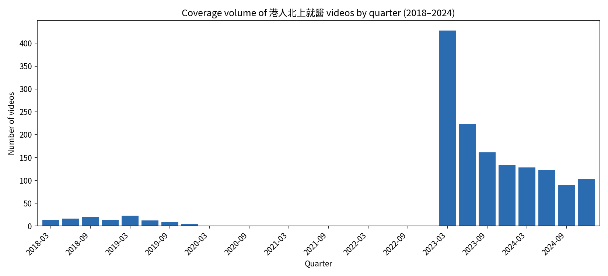
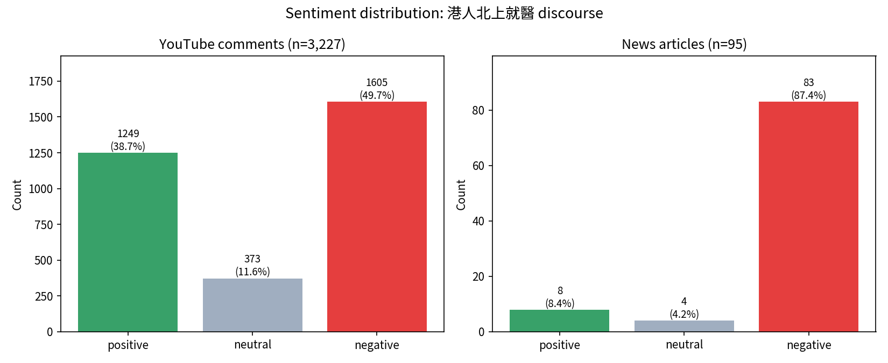
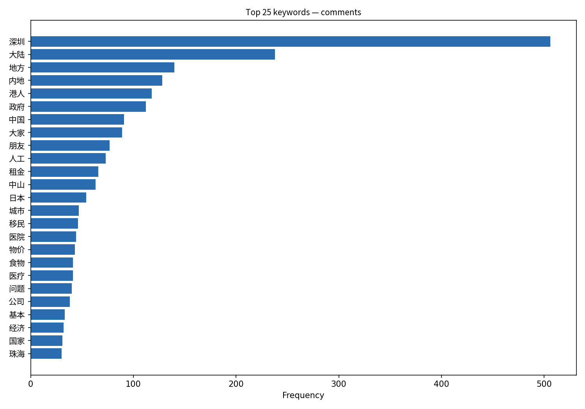
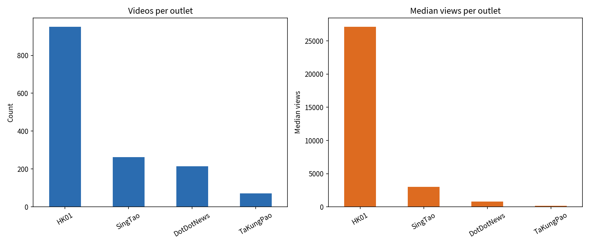

# Northbound for Care: A Computational Study of Hong Kong's 港人北上就醫 Discourse

An undergraduate computational-social-science portfolio project examining how
Hong Kong residents travelling north to mainland China for medical care are
covered by news outlets and discussed online.

> **Portfolio summary** — The original study analysed 1,500 YouTube videos
> (2018–2024), 3,267 public comments, and 95 news articles. Coverage peaked
> in Q1 2023 after the border reopened; 49.7% of scored comments were
> classified as negative. This public repository shares the analytical code,
> figures, synthetic schema examples, and aggregate outputs — not the original
> full-text corpus or platform exports.

## Research questions

1. **How much, and when**, did HK media cover 港人北上就醫 between 2018 and 2024?
2. **What themes** dominate news framing versus public conversation?
3. **How does the public feel** about northbound care, and which concerns surface?
4. **Do outlets differ** in coverage volume and audience reach?

## What is public in this repository

| Material | Purpose |
|---|---|
| `src/` | Reusable collection, anonymisation, NLP, sentiment, topic-model, and trend-analysis code |
| `figures/` | Final aggregate visualisations used to communicate findings |
| `data/public/` | Aggregate tables without text, URLs, platform identifiers, or author information |
| `data/sample/` | Clearly labelled synthetic metadata for inspecting the expected schema |
| `docs/` | Data, ethics, and public-release documentation |

Outlets analysed in the original study: **HK01, 星島 (SingTao), 點新聞
(DotDotNews), 大公報 (TaKungPao)**. See [`docs/DATA.md`](docs/DATA.md) and
[`docs/ETHICS.md`](docs/ETHICS.md).

## Methods

| Stage | Tool | Module |
|---|---|---|
| News scraping | Selenium + webdriver-manager | `src/scraping/google_news.py` |
| YouTube collection | YouTube Data API v3 | `src/scraping/youtube_videos.py`, `youtube_comments.py` |
| Anonymisation | Salted SHA-256 hashing + PII redaction | `src/preprocessing/anonymize.py` |
| Chinese tokenisation | jieba + PyCantonese stopwords, noun extraction | `src/preprocessing/text_cleaning.py` |
| Sentiment | SnowNLP | `src/analysis/sentiment.py` |
| Topic modelling | Gensim LDA with c_v coherence selection | `src/analysis/topic_modeling.py` |
| Trends and outlet comparison | pandas + matplotlib | `src/analysis/trends.py` |

## Key findings

### Coverage surged when the boundary reopened

Video coverage was negligible in 2020–2022 and rose to a **peak of 428 videos
in Q1 2023**.



### Public sentiment was predominantly negative

Of 3,227 scored comments, **49.7% were negative** and 38.7% positive.



### The conversation centred on cross-boundary life and healthcare

Aggregate keyword patterns foregrounded Shenzhen, mainland China, cost of
living, healthcare, and the Hong Kong economy.



### HK01 accounted for the largest share of collected coverage

HK01 contributed 951 of 1,500 collected videos, with a median 27,123 views.



## Use this portfolio repository

```bash
pip install -r requirements.txt
make public-check
```

To collect new data yourself, copy `.env.example` to `.env` and replace the
placeholder with your own YouTube Data API credential. The complete historical
corpus is intentionally not redistributed; therefore this repository is a
transparent portfolio and methods release, not a full-data replication package.

## Repository structure

```text
hk-northbound-healthcare/
├── README.md
├── requirements.txt · Makefile · .env.example · .gitignore
├── data/
│   ├── public/         # aggregate, public-safe tables
│   ├── sample/         # synthetic schema example
│   ├── raw/            # intentionally empty in the public release
│   └── processed/      # intentionally empty in the public release
├── src/
│   ├── config.py       # paths + secrets, no hardcoding
│   ├── scraping/       # Google News, YouTube videos, YouTube comments
│   ├── preprocessing/  # anonymisation and consolidation
│   └── analysis/       # sentiment, topic, word-frequency, and trend modules
├── resources/          # public stopwords list; dictionary is local-only
├── figures/            # generated aggregate charts
└── docs/               # data and ethics documentation
```

## Limitations

Sentiment is model-inferred and noisy on Cantonese slang. The original
collection is query-based rather than a census of all related online content.
Findings are aggregate and descriptive; they should not be interpreted as
ground truth about individual commenters.

## License

Code: MIT (see `LICENSE`). Public aggregate outputs: academic, non-commercial
use only — see [`docs/ETHICS.md`](docs/ETHICS.md).

---
*Author: Doris Wang · Applicant, MSc Social Data Analytics.*
